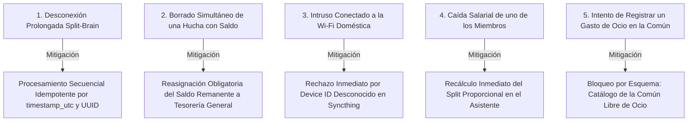
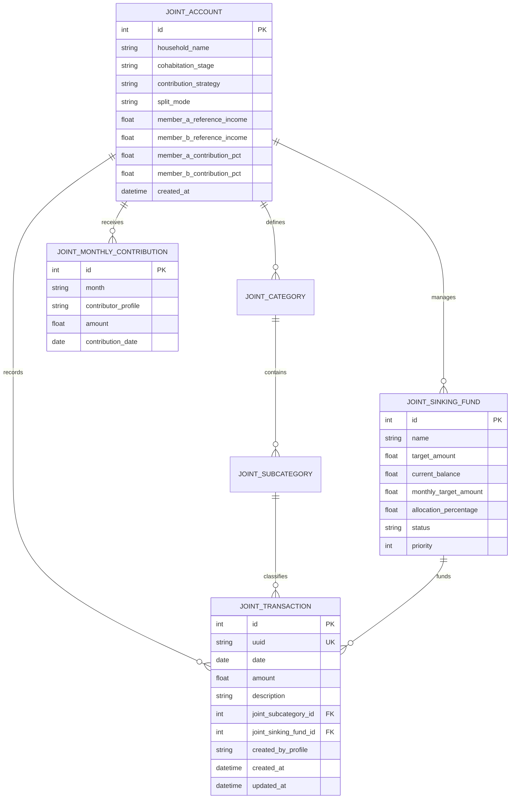

# Especificación 010: Arquitectura Multi-Perfil para Parejas y Finanzas Compartidas (Privacidad Real y Cuenta Conjunta Sincronizada)

## 1. Resumen Ejecutivo y Visión

Actualmente, el **Gestor de Finanzas Personales** está diseñado como un sistema monousuario y estrictamente local. Sin embargo, en la vida real, la gestión económica en pareja exige coordinar gastos comunes del hogar y metas de ahorro conjuntas (vivienda, viajes, coche, fondo de emergencia familiar) sin renunciar a la **privacidad real e inviolable de los gastos, patrimonio y decisiones individuales**.

Las soluciones existentes en el mercado fracasan en este propósito:
- Los servicios en la nube (SaaS como YNAB o Monarch Money) centralizan los datos en servidores externos (vulnerando los **Principios 1 y 10 de la Constitución**) y ofrecen una privacidad ficticia (*security through obscurity*) o asimétrica (el administrador del grupo tiene acceso irrestricto a los presupuestos de todos los miembros).
- Las herramientas de reparto de gastos (como Splitwise o Tricount) son simples calculadoras de deudas entre amigos (*IOU ledgers*) que no gestionan presupuestos, ni ahorro patrimonial, ni fondos de emergencia, introduciendo una constante fricción psicológica en la pareja al obligar a contar céntimos de compras cotidianas.

El **objetivo** de esta especificación es implementar una **Arquitectura Multi-Perfil para Parejas basada en el Modelo de Fondo Común del Hogar y Fondos de Amortización con Sincronización Asíncrona Local-First**:
- **Privacidad Real Inviolable (Aislamiento Físico por Dispositivo)**: Dos dispositivos físicos independientes (ej. PC Windows para el Usuario A y Mac con macOS para el Usuario B). Los datos privados personales (ingresos, gastos de ocio, inversiones privadas) residen exclusivamente en el disco local de cada máquina y **jamás se sincronizan ni transmiten por la red**.
- **Base de Datos Unificada y Desacoplada**: Una única base de datos `finanzas.db` en cada máquina, incorporando entidades desacopladas para el espacio conjunto. SQLite nunca se expone a la red ni a carpetas compartidas directas, previniendo corrupciones de bloqueo (*locks* y ficheros WAL).
- **Transporte Asíncrono Cifrado con Syncthing**: Sincronización P2P punto a punto mediante TLS 1.3 sin servidores centrales. El backend de Python opera de forma 100% local sobre disco (`pathlib.Path`), depositando y consumiendo eventos atómicos en un buzón de deltas JSON (`sync/outbox/` e `sync/inbox/`).
- **Blindaje Criptográfico ante Intrusos en la Wi-Fi**: Autenticación mutua obligatoria mediante identificadores de dispositivo (*Device IDs* derivados de certificados TLS X.509 de 56 caracteres). Ningún tercero conectado a la misma red Wi-Fi puede acceder ni recibir datos.
- **Filosofía Contable de Fondo Común (Sin Calculadora de Deudas)**: Aportaciones periódicas pactadas hacia la Cuenta Conjunta. La cuenta común gestiona su propia tesorería para pagar **Necesidades Básicas del Hogar** y dotar **Huchas de Amortización / Metas de Futuro (*Joint Sinking Funds*)**.
- **Prohibición Estricta de Ocio en la Cuenta Conjunta**: Todo el ocio y deseos individuales se costean íntegramente desde la cuenta personal de cada uno con su 30% de Deseos (*Wants*). Cero mezcla contable.
- **Flexibilidad ante el Ciclo de Vida de la Pareja**: Adaptado tanto a parejas que aún no conviven (100% aportación a huchas de futuro, 0% facturas de necesidades) como a parejas en convivencia plena.
- **Modo Asistido con Ejecución en 1 Clic**: Generación y asiento automático o asistido de la aportación mensual recurrente al abrir un nuevo mes.
- **Diagnóstico Determinista de Salud Financiera del Hogar**: Semáforo cuantitativo que audita la tasa de esfuerzo familiar frente a los ingresos combinados, alertando si el hogar está viviendo por encima de sus posibilidades.

---

## 2. Usuarios y Casos de Uso

- **Pareja en Fase de Ahorro / Previa a la Convivencia (No viven juntos aún)**:
  - Viven en domicilios separados y desean construir un patrimonio común (hucha para la entrada de un futuro piso, vacaciones juntos, fondo para un coche).
  - Configuran la Cuenta Conjunta con gastos de necesidades en 0,00 € y aportan una cantidad mensual fija o porcentual que va 100% destinada a las huchas de amortización.
- **Pareja en Convivencia Plena (Viven juntos)**:
  - Comparten alquiler/hipoteca, suministros del hogar y supermercado.
  - Aportan a la cuenta común a principios de mes (mediante reparto 50/50, proporcional a ingresos o personalizado) para cubrir tanto las necesidades del mes como las huchas de ahorro familiar.
- **Usuario Individual / Estado Inicial Cero (Sin Cuenta Conjunta configurada)**:
  - Gestiona exclusivamente sus finanzas personales individuales.
  - La aplicación opera en modo monousuario estricto con cero intrusión: las tablas de la cuenta conjunta permanecen vacías, no aparecen banners ni recordatorios de aportación en el perfil personal, y al acceder a la vista conjunta se le ofrece un asistente de bienvenida opcional.
- **Usuario que Protege su Privacidad Personal**:
  - Desea comprar un regalo sorpresa de aniversario para su pareja, ropa personal o salir a cenar con sus amigos sin que su pareja reciba una notificación del importe o del comercio en su teléfono/ordenador.
  - El gasto se anota en su perfil personal bajo su 30% de Deseos; dicho apunte jamás sale de su disco duro.
- **Usuario en Movilidad o con Dispositivos Heterogéneos (Windows + Mac)**:
  - El Usuario A gestiona sus finanzas en su PC con Windows 11; el Usuario B en su MacBook con macOS.
  - La sincronización ocurre de forma desatendida y silenciosa mediante Syncthing sin cortes por suspensión de tapa en Mac.

---

## 3. Historias de Usuario (HU)

- **HU-1 (Aislamiento de Perfiles y Privacidad Total)**: Como usuario del gestor, quiero que mis gastos personales, inversiones y cuentas privadas residan exclusivamente en mi ordenador local para garantizar que nadie pueda verlos sin mi consentimiento físico.
- **HU-2 (Configuración de la Cuenta Conjunta y Modalidad de Aportación)**: Como pareja, queremos configurar el presupuesto de nuestro hogar y elegir el método de reparto de la aportación (50/50, proporcional al sueldo o personalizado) para que el esfuerzo sea justo y transparente.
- **HU-3 (Gestión de Huchas de Amortización / Metas de Futuro)**: Como pareja, queremos crear huchas de ahorro con objetivos en euros (Entrada de piso, Vacaciones, Coche, Emergencia del Hogar) y ver el progreso acumulado mes a mes.
- **HU-4 (Asentamiento Asistido de la Aportación Mensual)**: Como usuario que cobra su nómina a principio de mes, quiero que al abrir el gestor se me proponga con un solo clic registrar la aportación pactada a la cuenta conjunta, registrando el gasto en mis necesidades personales y el ingreso en la cuenta común.
- **HU-5 (Sincronización P2P Segura y Asíncrona)**: Como pareja que no siempre tiene el ordenador encendido al mismo tiempo, queremos que los movimientos de la cuenta común se sincronicen en segundo plano vía Syncthing de forma cifrada cuando ambos equipos se conecten a la red.
- **HU-6 (Diagnóstico de Salud Financiera Familiar)**: Como miembro de la pareja, quiero conocer el semáforo de esfuerzo de nuestro hogar para saber si nuestros costes fijos comunes superan el 50% de nuestros ingresos combinados y evitar vivir por encima de nuestras posibilidades.
- **HU-7 (Blindaje de Ocio en la Cuenta Común)**: Como usuario que protege la armonía de pareja, quiero que la cuenta conjunta no admita categorías de ocio individual para evitar disputas sobre compras personales.
- **HU-8 (Restablecimiento Completo / Vuelta a Estado Cero)**: Como usuario que está probando la cuenta conjunta o que decide desvincularla, quiero disponer de una opción clara para desactivar la cuenta conjunta y purgar sus datos en 1 clic para volver al Estado Cero de monousuario sin dejar rastros en mi aplicación personal.
- **HU-9 (Onboarding Guiado Asimétrico / Unirse al Hogar en 1 Clic)**: Como miembro de la pareja que abre la app en su ordenador tras haber configurado mi pareja el hogar, quiero que el sistema detecte la configuración recibida por Syncthing y me permita unirme con 1 solo clic asignándome mi perfil automáticamente, sin tener que volver a rellenar el formulario ni correr el riesgo de introducir datos discordantes.

---

## 4. Requisitos Funcionales (RF)

### RF-1: Modelo de Datos Desacoplado en `finanzas.db`
- **Criterio EARS (Ubiquitous)**: EL SISTEMA DEBE almacenar tanto las entidades personales como las compartidas dentro del fichero SQLite local `finanzas.db` de cada usuario mediante esquemas declarativos de SQLAlchemy 2.0.
- **Criterio EARS (Ubiquitous)**: Al inicializar el backend mediante `Base.metadata.create_all`, EL SISTEMA DEBE generar las tablas conjuntas vacías (0 registros DML). Las entidades de configuración y el catálogo de subcategorías se poblarán exclusivamente cuando el usuario complete el Asistente de Configuración Inicial.
- **Criterio EARS (Ubiquitous)**: EL SISTEMA DEBE limitar estrictamente el espacio compartido a **exactamente una (1) Cuenta Conjunta del Hogar** por base de datos local (`Singleton Household`), diseñada para la coordinación económica entre los dos miembros de la pareja (`local_profile` y `remote_profile`). Queda fuera de alcance el soporte para múltiples grupos simultáneos.
- **Criterio EARS (Ubiquitous)**: EL SISTEMA DEBE implementar las siguientes entidades para el espacio conjunto:
  1. `JointAccount`: Configuración del hogar, nombre del hogar, etapa de convivencia (`PRE_COHABITATION`, `COHABITATION`), estrategia de determinación de aportación (`NOMINAL_TEMPLATE`, `INCOME_PERCENTAGE`), modalidad de reparto por defecto (`EQUAL_50_50`, `INCOME_PROPORTIONAL`, `CUSTOM_FIXED`), ingresos de referencia de ambos miembros, porcentajes de aportación pactados (`member_a_contribution_pct`, `member_b_contribution_pct`) y fecha de creación.
  2. `JointCategory` y `JointSubcategory`: Catálogo estandarizado de conceptos del hogar dividido exclusivamente en:
     - **Necesidades Básicas del Hogar**: `Vivienda (Alquiler/Hipoteca)`, `Suministros (Luz, Agua, Gas, Internet)`, `Alimentación y Supermercado`, `Comunidad y Seguros`.
     - **Prohibición Explícita**: Queda terminantemente prohibido dar de alta categorías de Ocio o Deseos en la Cuenta Conjunta.
  3. `JointSinkingFund` (Huchas de Amortización del Hogar): Identificador único, nombre de la meta (ej. *Entrada Vivienda*, *Viajes*, *Fondo Coche*, *Emergencia Hogar*), importe objetivo (`target_amount`), saldo acumulado actual (`current_balance`), cuota mensual nominal fijada (`monthly_target_amount`), porcentaje de asignación relativo (`allocation_percentage`), prioridad y estado (`ACTIVE`, `COMPLETED`, `PAUSED`).
  4. `JointTransaction`: Transacción real del hogar con identificador global `uuid` (UUIDv4), fecha, importe, `joint_subcategory_id` (o `joint_sinking_fund_id` si es dotación o retiro de hucha), descripción, perfil originador (`created_by_profile`), timestamp UTC de creación y timestamp UTC de modificación.
  5. `JointMonthlyContribution`: Registro de las aportaciones mensuales efectuadas por cada miembro, indicando mes (`YYYY-MM`), perfil aportante, importe aportado y fecha de asiento.

### RF-2: Mecanismo de Aportación, Identidad de Miembros y Estrategias de Determinación
- **Criterio EARS (Ubiquitous)**: EL SISTEMA DEBE diferenciar inequívocamente al miembro local del miembro remoto en cada ordenador:
  - En el PC del Usuario A: el perfil local se identifica como `local_profile = "MEMBER_A"` (ej. "Raúl"), mientras que su pareja se registra como `remote_profile = "MEMBER_B"`.
  - En el Mac del Usuario B: el perfil local se identifica como `local_profile = "MEMBER_B"`, y su pareja como `remote_profile = "MEMBER_A"`.
  - Cada máquina utiliza su propia identidad local para calcular y mostrar: *"Tu cuota este mes es de X,XX €"*.
- **Criterio EARS (State-driven)**: MIENTRAS se configure o recalibre la aportación del hogar, en **AMBAS etapas de convivencia (Pre-Convivencia y Convivencia Plena)**, EL SISTEMA DEBE permitir elegir entre dos estrategias fundamentales de determinación del dinero a aportar:
  1. **Estrategia A: Basada en Plantilla Nominal en Euros ("Bottom-Up")**:
     - Se fijan importes específicos en euros para cada concepto del hogar o fondo de amortización (ej. 400 €/mes Entrada de Vivienda + 200 €/mes Vacaciones = 600 €/mes en Pre-Convivencia; o 1.400 € Necesidades + 400 € Huchas = 1.800 € en Convivencia Plena).
     - El importe total es la suma matemática de dichas cuotas nominales fijadas.
     - Dicho total se distribuye entre los miembros según la modalidad elegida:
       - **Modalidad A.1 (Igual 50% / 50%)**: Cada miembro aporta el 50% del total.
       - **Modalidad A.2 (Proporcional a Ingresos)**: Cada miembro aporta según su ratio de ingresos:
         $$\text{Aportación Local} = \text{Presupuesto Total Hogar} \times \frac{\text{Ingresos Local}}{\text{Ingresos A} + \text{Ingresos B}}$$
       - **Modalidad A.3 (Personalizada / Fija Pactada)**: Cifras cerradas en euros pactadas por cada miembro.
  2. **Estrategia B: Basada en Porcentaje Fijo de Ingresos ("Top-Down" Dinámico)**:
     - Cada miembro destina un porcentaje de sus ingresos reales del mes (ej. el 20% cada uno, o porcentajes específicos convenidos como 25% Usuario A y 20% Usuario B):
       $$\text{Aportación Local} = \text{Ingresos Reales Mes Local} \times \text{Porcentaje Pactado Local}$$
     - La recaudación total conjunta resulta de la suma de ambas aportaciones porcentuales (sea cual sea el importe resultante en euros).
     - **Distribución Porcentual en Fondos**: Dicha recaudación conjunta se distribuye automáticamente entre los fondos de amortización activos de acuerdo a sus porcentajes relativos asignados (`allocation_percentage`, sumando 100% entre las huchas activas; en Convivencia Plena, tras cubrir las facturas de necesidades del mes).
- **Criterio EARS (Event-driven)**: CUANDO cualquiera de los miembros desee aportar un extra puntual (ej. proveniente de una paga extraordinaria o bonus laboral), EL SISTEMA DEBE permitir registrar una **Aportación Extraordinaria**, canalizándola directamente a la tesorería general o a una hucha de amortización específica sin alterar la cuota fija mensual pactada.
- **Criterio EARS (Event-driven)**: CUANDO la pareja decida cambiar de estrategia de determinación (Nominal vs Porcentaje de ingresos) o modalidad de cálculo, EL SISTEMA DEBE permitir modificar los ajustes en cualquier momento desde la pantalla de Configuración del Hogar, aplicando los nuevos cálculos exclusivamente a los meses futuros sin alterar los meses históricos ya cerrados.

### RF-3: Soporte y Gestión en UI del Ciclo de Vida de la Pareja (Pre-Convivencia y Convivencia Plena)
- **Criterio EARS (Ubiquitous)**: EL SISTEMA DEBE proporcionar un selector explícito de etapa de convivencia en los Ajustes de la Cuenta Conjunta con dos estados:
  - 🔘 **Modo Pre-Convivencia ("Construyendo Futuro")**: Para parejas que aún no viven juntas.
  - 🔘 **Modo Convivencia Plena ("Hogar en Común")**: Para parejas que conviven en el mismo domicilio.
- **Criterio EARS (State-driven)**: MIENTRAS la pareja se encuentre en etapa de **Pre-Convivencia**:
  - **Ocultamiento de Necesidades en la UI**: El presupuesto de Necesidades Básicas del hogar se establece en **0,00 €** y se ocultan visualmente los campos de alquiler, suministros y supermercado para evitar ruido visual.
  - **Doble Opción de Cálculo de Aportación**:
    - Si se usa **Estrategia Nominal**: El total mensual se fija sumando los importes nominales en euros de las huchas activas (`monthly_target_amount`).
    - Si se usa **Estrategia de Porcentaje de Ingresos**: El total mensual resulta de la recaudación porcentual de ambos miembros y se reparte entre las huchas según su `allocation_percentage`.
  - El formulario de nuevos gastos conjuntos solo permite seleccionar como origen una Hucha de Amortización activa.
- **Criterio EARS (State-driven)**: MIENTRAS la pareja se encuentre en etapa de **Convivencia Plena**:
  - Se habilitan las subcategorías de costes fijos del hogar (alquiler/hipoteca, suministros, supermercado).
  - El presupuesto total del hogar cubre la suma de: **Necesidades Básicas del Hogar + Cuota de Dotación de Huchas de Amortización** (bajo estrategia nominal o porcentual).
- **Criterio EARS (Event-driven)**: CUANDO la pareja decida iniciar la convivencia y cambie el selector a "Convivencia Plena", EL SISTEMA DEBE preservar íntegramente todos los saldos e históricos de las huchas creadas en la etapa previa y activar el asistente de configuración de costes fijos de la vivienda.

### RF-4: Integración Contable con el Presupuesto Personal 50/30/20
- **Criterio EARS (State-driven)**: MIENTRAS se encuentre en etapa de **Pre-Convivencia**, EL SISTEMA DEBE permitir al usuario elegir en su perfil personal cómo computa su aportación a las huchas de futuro:
  1. **Opción A (Ahorro e Inversión)**: Imputa a su 20% personal bajo la subcategoría `Ahorro Futuro Común`.
  2. **Opción B (Necesidades Básicas)**: Imputa a su 50% personal como compromiso fijo pactado bajo `Aportación a Cuenta Conjunta`.
- **Criterio EARS (State-driven)**: MIENTRAS se encuentre en etapa de **Convivencia Plena**, la aportación mensual computa obligatoriamente como **Necesidades Básicas -> `Aportación a Cuenta Conjunta`**.
- **Criterio EARS (State-driven)**: MIENTRAS el usuario mantenga además necesidades personales exclusivas (ej. abono transporte personal, seguro médico propio) y la suma de su aportación conjunta más sus gastos personales exceda el 50% de sus ingresos netos:
  - EL SISTEMA DEBE transparentar el porcentaje real alcanzado (ej. 55% en Necesidades).
  - EL SISTEMA DEBE aplicar la regla determinista de pautas presupuestarias: el sobrecoste se amortigua contrayendo de forma natural el margen de Deseos (reduciendo el 30% a 25%), manteniendo inalterado y blindado el 20% de Ahorro e Inversión personal.

### RF-5: Flujo de Aportación Asistida al Inicio de Mes y Flexibilidad de Ajuste
- **Criterio EARS (State-driven)**: MIENTRAS exista una Cuenta Conjunta activa y configurada (`JointAccount` presente en base de datos) Y el usuario abra la aplicación en un mes nuevo natural (`YYYY-MM`) sin que se haya registrado la aportación de dicho mes:
  - EL SISTEMA DEBE renderizar en la cabecera del perfil personal un componente destacado de notificación:
    `📅 Nuevo Mes Detectado: [Nombre Mes] | Tu Aportación pactada al Hogar: [X,XX €] (Modalidad: [Tipo])`
  - Incluyendo dos botones de acción: `[⚡ Asentar Aportación]` y `[✏️ Modificar Importe]`.
- **Criterio EARS (State-driven)**: MIENTRAS NO exista un registro en `JointAccount` (modo usuario individual / sin configurar):
  - EL SISTEMA DEBE garantizar cero intrusión en el perfil personal: queda terminantemente prohibido renderizar este banner, notificaciones o alertas de aportación, preservando la experiencia monousuario intacta.
- **Criterio EARS (Event-driven)**: CUANDO el usuario pulse `[✏️ Modificar Importe]`, EL SISTEMA DEBE abrir un diálogo emergente (*popover* o modal) que permita:
  1. Alterar la cifra exacta en euros a aportar para ese mes específico (ej. por un gasto médico imprevisto o mayor capacidad puntual).
  2. Cambiar temporalmente la modalidad de cálculo para el mes en curso sin modificar la configuración base por defecto.
- **Criterio EARS (Event-driven)**: CUANDO el usuario confirme o pulse `[⚡ Asentar Aportación]`:
  1. Inserta la transacción de gasto en su perfil personal (`-X.XX €` en Necesidades o Ahorro según la etapa).
  2. Inserta la transacción de ingreso en la tesorería de la Cuenta Conjunta (`+X.XX €`).
  3. Genera y deposita de forma inmediata el evento delta de aportación en la carpeta `sync/outbox/` para su sincronización vía Syncthing.
  4. Notifica el éxito mediante un aviso emergente (`st.toast`) y actualiza las métricas en pantalla.

### RF-6: Huchas de Amortización del Hogar (*Joint Sinking Funds*)
- **Criterio EARS (Ubiquitous)**: EL SISTEMA DEBE permitir la creación, edición, pausado y liquidación de huchas de amortización personalizadas para el hogar (Entrada de vivienda, Fondo Coche, Viajes en pareja, Fondo de Emergencia del Hogar).
- **Criterio EARS (State-driven)**: MIENTRAS se visualice el panel de Huchas Conjuntas, EL SISTEMA DEBE mostrar tarjetas visuales con:
  - Saldo acumulado actual en euros.
  - Objetivo monetario y porcentaje de progreso completado.
  - Estimación de meses restantes para alcanzar la meta según el ritmo de aportación mensual.
- **Criterio EARS (Event-driven)**: CUANDO se produzca un gasto financiado por una hucha (ej. compra de billetes de viaje o pago de la fianza del piso), EL SISTEMA DEBE descontar el importe del saldo acumulado de dicha hucha y reflejarlo en el historial de gastos comunes.

### RF-7: Diagnóstico de Salud Financiera del Hogar
- **Criterio EARS (State-driven)**: MIENTRAS se evalúe el presupuesto del hogar en la pantalla de configuración o en el panel conjunto, EL SISTEMA DEBE calcular la Tasa de Esfuerzo Familiar:
  $$\text{Tasa de Esfuerzo} = \frac{\text{Gastos Fijos de Necesidades del Hogar}}{\text{Ingresos Combinados de Ambos}}$$
- **Criterio EARS (State-driven)**: MIENTRAS se analice dicha tasa, EL SISTEMA DEBE clasificarla bajo el semáforo determinista:
  - 🟢 **Tasa < 50% (Hogar Sostenible)**: Presupuesto equilibrado con amplio margen para nutrir huchas de ahorro.
  - 🟡 **Tasa entre 50% y 60% (Zona de Tensión)**: Los costes fijos aprietan; el ahorro del hogar requiere contención de gastos personales.
  - 🔴 **Tasa > 60% (Viviendo por encima de vuestras posibilidades)**: Alerta severa de estrés financiero estructural; el hogar carece de margen ante imprevistos.

### RF-8: Motor de Sincronización Asíncrona Desacoplada (Event Sourcing Inbox/Outbox)
- **Criterio EARS (Ubiquitous)**: EL SISTEMA DEBE operar la sincronización mediante lectura y escritura exclusiva de archivos en disco local bajo una carpeta dedicada (`sync/`), sin abrir puertos de red ni sockets TCP en FastAPI.
- **Criterio EARS (Event-driven)**: CUANDO se inserte, modifique o elimine un registro en la Cuenta Conjunta en el equipo de un usuario:
  - EL SISTEMA DEBE generar un fichero JSON atómico en `sync/outbox/evt_<uuid>.json` con la estructura:
    ```json
    {
      "event_id": "UUIDv4",
      "entity_type": "TRANSACTION | CONTRIBUTION | SINKING_FUND",
      "action": "UPSERT | DELETE",
      "origin_device_id": "STRING",
      "timestamp_utc": "ISO-8601",
      "payload": { ... }
    }
    ```
- **Criterio EARS (State-driven)**: MIENTRAS el backend detecte archivos en `sync/inbox/` (depositados por Syncthing desde el otro ordenador):
  - EL SISTEMA DEBE procesar los eventos en orden cronológico por `timestamp_utc`.
  - EL SISTEMA DEBE aplicar los cambios en la base de datos local SQLite de forma **idempotente** (si un evento con un `event_id` ya fue procesado, se descarta silenciosamente).
  - Al procesar con éxito el evento, EL SISTEMA DEBE archivar o eliminar el fichero de la bandeja de entrada para evitar reprocesamientos.

### RF-9: Resolución Determinista de Conflictos (LWW y Tombstones)
- **Criterio EARS (State-driven)**: MIENTRAS ocurra una edición simultánea sobre el mismo registro en ambos equipos durante una desconexión:
  - EL SISTEMA DEBE resolver la colisión aplicando la regla determinista **Last-Write-Wins (LWW)** basada en el campo `timestamp_utc`.
- **Criterio EARS (Event-driven)**: CUANDO un usuario elimine un movimiento de la cuenta común:
  - EL SISTEMA DEBE emitir un evento con `action: "DELETE"` (*tombstone*).
  - Al procesarse en el otro equipo, elimina la transacción local y revierte de forma atómica el saldo de la hucha o tesorería asociada.

### RF-10: Blindaje de Seguridad Criptográfica y Transporte Syncthing
- **Criterio EARS (Ubiquitous)**: La sincronización entre el PC de Usuario A y el Mac de Usuario B se delegará en la herramienta local **Syncthing**:
  - Emparejamiento obligatorio bidireccional mediante **Device IDs** (claves públicas TLS X.509 de 56 caracteres).
  - Toda transmisión de datos por la red Wi-Fi o Internet viaja cifrada con **TLS 1.3**.
  - Si un dispositivo ajeno se conecta a la misma red Wi-Fi, Syncthing descarta cualquier comunicación al no coincidir su Device ID con la lista de permitidos.

### RF-11: Interfaz de Usuario en Streamlit — Arquitectura de Dos Pantallas 100% Independientes
- **Criterio EARS (Ubiquitous)**: EL SISTEMA DEBE estructurar la aplicación en **dos pantallas visuales y funcionales completamente independientes**, alternables mediante un selector de contexto destacado en la cabecera de la barra lateral (`st.sidebar.radio` o selector dedicado):
  - 🔘 `👤 Mi Perfil Personal`
  - 🔘 `👥 Economía del Hogar (Cuenta Conjunta)`
- **Criterio EARS (State-driven)**: MIENTRAS esté activo el modo `👤 Mi Perfil Personal`:
  - EL SISTEMA DEBE renderizar el cuadro de mandos individual existente en su totalidad (Resumen Anual Personal, 12 Meses con regla 50/30/20, Presupuesto Base, Radar Macro, Screener, Deep Dive, Copiloto Patrimonial y Comité Asesor).
  - Cero intrusión si la cuenta conjunta no está configurada. Si existe una cuenta conjunta activa, incorpora únicamente el banner discreto de inicio de mes de RF-5.
- **Criterio EARS (State-driven)**: MIENTRAS esté activo el modo `👥 Economía del Hogar (Cuenta Conjunta)` y NO exista un registro en `JointAccount` (Estado Cero):
  - EL SISTEMA DEBE renderizar el **Asistente de Bienvenida / Onboarding Inicial**, explicando la privacidad local-first y ofreciendo el botón `[✨ Configurar Espacio Compartido]`, el cual guía al usuario en la definición de nombre del hogar, etapa de convivencia y modalidad de aportación antes de habilitar la gestión común.
- **Criterio EARS (State-driven)**: MIENTRAS esté activo el modo `👥 Economía del Hogar (Cuenta Conjunta)` y la cuenta esté configurada:
  - EL SISTEMA DEBE ocultar por completo el menú y herramientas del perfil personal y renderizar una pantalla independiente con su propio selector de año del hogar y cuatro pestañas exclusivas:
    1. **📊 Resumen Anual del Hogar**:
       - Tarjetas de métricas consolidadas del hogar:
         - **Total gastado en Necesidades Comunes** (Alquiler/Hipoteca, Luz, Agua, Gas, Internet, Supermercado, Comunidad y Seguros).
         - **Total ahorrado en Huchas Conjuntas** (progreso anual acumulado en metas de ahorro).
         - **Semáforo y Tasa de Esfuerzo Familiar del año** (auditoría determinista de sostenibilidad financiera).
       - **Componente Gráfico Visual (Altair / Streamlit)**: Gráficos de barras apiladas/áreas mensuales mostrando la evolución de los gastos de necesidades y la dotación acumulada a las metas de futuro.
       - **PROHIBICIÓN EXPLÍCITA**: Queda terminantemente prohibido desglosar, comparar o computar en el Resumen Anual el "Total aportado por el Usuario A vs Usuario B". La economía del hogar se presenta como una unidad familiar unificada para preservar la armonía y evitar contabilidades de reproches.
    2. **📅 12 Meses del Hogar (Enero a Diciembre)**:
       - Resumen mensual de tesorería del hogar (saldo inicial, total recaudado por aportaciones, gastos comunes del mes y saldo remanente).
       - Formulario y tabla de gastos comunes (clasificados estrictamente bajo subcategorías de necesidades o cargos a huchas, sin categorías de ocio).
    3. **🎯 Huchas de Amortización / Metas de Futuro**:
       - Panel interactivo de huchas (Entrada de vivienda, Fondo Coche, Vacaciones, Emergencia Hogar).
       - Tarjetas con saldo actual acumulado, objetivo monetario, porcentaje de progreso, cuota mensual fijada y meses restantes estimados.
       - Botón para liquidar o ejecutar gastos directamente contra el saldo de la hucha.
    4. **⚙️ Configuración del Hogar y Sincronización**:
       - Estado del transporte Syncthing (Device IDs emparejados, timestamp del último delta procesado y botón para escaneo manual de `sync/inbox/`).
       - Conmutador de etapa de convivencia (Pre-Convivencia vs Convivencia Plena).
       - Ajustes de modalidad de cálculo (Nominal vs Porcentaje de ingresos) e ingresos de referencia de la pareja.
- **Criterio EARS (State-driven)**: MIENTRAS se visualice la Cuenta Conjunta, EL SISTEMA DEBE mostrar en la barra lateral el indicador de estado de sincronización (*"Última sincronización: hace X minutos"* o *"Sin conexión / Cambios locales pendientes"*).

### RF-8: Restablecimiento y Purga de Cuenta Conjunta (Volver a Estado Cero)
- **Criterio EARS (Event-driven)**: CUANDO el usuario confirme la acción de *"Desactivar Cuenta Conjunta y Volver al Estado Cero"* desde la pestaña de configuración, EL SISTEMA DEBE purgar físicamente todas las entidades del espacio conjunto (`JointAccount`, `JointTransaction`, `JointSinkingFund`, `JointMonthlyContribution`, `JointCategory`, `JointSubcategory`, `JointAppliedSyncEvent`), vaciar las carpetas de deltas locales (`sync/outbox/`, `sync/inbox/`, `sync/processed/`) y devolver la aplicación inmediatamente al Estado Cero monousuario sin alterar en absoluto ninguna tabla ni transacción del perfil personal.

### RF-9: Detección Automática de Invitación y Onboarding Único (Opción A)
- **Criterio EARS (Event-driven)**: CUANDO un usuario que se encuentre en Estado Cero acceda a la vista de Economía del Hogar y existan deltas de tipo `ACCOUNT` en la bandeja `sync/inbox/` emitidos por el dispositivo de la pareja, EL SISTEMA DEBE detectar la invitación y desplegar una tarjeta interactiva con el nombre del hogar y miembro originador (*"Se ha detectado el hogar '{household_name}' creado por {member_a_name}"*).
- **Criterio EARS (Event-driven)**: CUANDO el usuario pulse *"Unirse al Hogar en 1-Clic"*, EL SISTEMA DEBE adoptar de forma idéntica la configuración del hogar, asignar automáticamente los perfiles complementarios (`local_profile = MEMBER_B`, `remote_profile = MEMBER_A`), inicializar el catálogo de necesidades y activar la cuenta conjunta sin requerir que el segundo usuario vuelva a rellenar el formulario de onboarding ni arriesgar discordancias en los parámetros del hogar.

---

## 5. Requisitos No Funcionales (RNF)

- **RNF-1 (Convenciones de Idioma - Opción 1 de la Constitución)**:
  - Todo el código backend, modelos SQLAlchemy, esquemas Pydantic, endpoints de API, nombres de métodos y variables redactados **100% en inglés** (`JointAccount`, `JointTransaction`, `JointSinkingFund`, `JointMonthlyContribution`, `joint_sync_service.py`, `/joint/contributions`, `/joint/sinking-funds`).
  - Toda la interfaz de usuario en Streamlit, etiquetas, mensajes de toast, explicaciones y documentación redactados **100% en español**.
- **RNF-2 (Privacidad Local Absoluta - Principio 10)**:
  - Los datos personales privados jamás salen del equipo local. En la carpeta de sincronización de Syncthing solo se depositan eventos con información del espacio conjunto.
  - Queda prohibido enviar datos de transacciones o aportaciones a la API de Gemini.
- **RNF-3 (Prohibición de Datos en Git - Principio 11)**:
  - La carpeta de sincronización local `sync/` y la base de datos `finanzas.db` quedan estrictamente registradas en `.gitignore`.
- **RNF-4 (Rendimiento y Localidad Estricta - Principio 1)**:
  - Tiempo de procesamiento de deltas en backend < 15 milisegundos por evento.
  - Cero dependencias de servidores externos o servicios en la nube para la sincronización.
- **RNF-5 (Observabilidad y Prohibición de Fallos Silenciosos - Principio 13)**:
  - Todo procesamiento de eventos de sincronización, importación o fallo de deserialización JSON debe instrumentarse con `logging` estructurado en `logs/backend.log`, registrando el UUID del evento y la causa del error sin interrumpir la interfaz de usuario.
- **RNF-6 (Veracidad Cuantitativa y Cobertura de Pruebas - Principio 6)**:
  - 100% de pruebas unitarias y de integración pasando con `pytest` en `tests/unit/` y `tests/integration/` para todos los nuevos servicios y routers.

---

## 6. Casos Límite y Reglas de Negocio (Edge Cases)



1. **Desconexión Prolongada (*Split-Brain*)**:
   - Si uno de los miembros viaja durante varias semanas sin conexión a la red de casa, las transacciones se acumulan en su outbox local. Al restablecerse la conectividad, Syncthing transfiere la ráfaga de deltas acumulados y el backend los procesa secuencialmente en orden cronológico por `timestamp_utc`, garantizando convergencia matemática total sin duplicados.
2. **Eliminación de una Hucha con Saldo Positivo**:
   - Si se decide cerrar o eliminar una meta de amortización que contiene dinero acumulado, el sistema exige reasignar el saldo a otra hucha activa o liberarlo hacia la tesorería general del hogar, impidiendo la destrucción accidental de capital.
3. **Dispositivo Desconocido en la Red Wi-Fi**:
   - El protocolo de Syncthing rechaza cualquier handshake de dispositivos que no hayan sido autorizados manualmente mediante su Device ID.
4. **Modificación de Ingresos Personales**:
   - Si un miembro experimenta un aumento o bajada de salario y se utiliza la Modalidad Proporcional, la actualización de sus ingresos recalcula de inmediato las cuotas futuras de aportación en la Plantilla Base del Hogar sin alterar los meses ya cerrados.
5. **Intento de Introducir Ocio en la Cuenta Conjunta**:
   - El catálogo `JointCategory` carece de partidas de ocio; la interfaz no ofrece opciones de ocio para la cuenta común, asegurando que las salidas personales se costeen desde los presupuestos individuales de Deseos.
6. **Usuario Individual sin Cuenta Conjunta (Estado Cero y Cero Intrusión)**:
   - Mientras `JointAccount` no exista en base de datos, la app bloquea cualquier consulta a endpoints del hogar en el perfil personal y no despliega avisos ni banners mensuales. Al acceder a la vista conjunta, se activa el Asistente de Bienvenida sin generar registros de forma anticipada.
7. **Restricción de Hogar Único (Singleton Household)**:
   - Si se intenta invocar la creación de una segunda cuenta conjunta existiendo ya una registrada, el backend rechaza la operación con código HTTP 409 Conflict o validación de unicidad en base de datos.
8. **Preservación de la Armonía en Resúmenes Anuales (Sin Marcadores Individuales)**:
   - El Resumen Anual conjunto prohíbe explícitamente desglosar cuánto aportó el Usuario A frente al Usuario B. La evaluación anual mide únicamente el gasto total del hogar, el ahorro conjunto acumulado y la tasa de esfuerzo familiar consolidada con sus correspondientes gráficas visuales.

---

## 7. Arquitectura de Datos y Entidades



---

## 8. Criterios de Aceptación y Validación

1. **Aislamiento Verificado**:
   - Comprobar que en la carpeta de sincronización `sync/` únicamente existan ficheros JSON con metadatos y movimientos de la Cuenta Conjunta; ningún registro de gastos u ocio personal debe generarse en dicha carpeta.
2. **Cálculo de Aportaciones Exacto**:
   - Validar que las tres modalidades de cálculo (50/50, proporcional y personalizada) generen los importes matemáticos exactos en las pruebas unitarias.
3. **Flujo de Asiento Asistido en 1 Clic**:
   - Verificar que al pulsar `[⚡ Asentar Aportación]` se cree de forma atómica la transacción de gasto en Necesidades en el perfil personal y el ingreso en la cuenta común, junto con el delta en `sync/outbox/`.
4. **Idempotencia de Sincronización**:
   - Enviar intencionadamente un mismo evento JSON dos veces al buzón de entrada y certificar que la base de datos lo procesa una sola vez sin duplicar importes.
5. **Resolución de Conflictos LWW**:
   - Simular dos ediciones concurrentes sobre el mismo `uuid` y verificar que el estado final adoptado corresponda al de mayor `timestamp_utc`.
6. **Compilación y Tipado**:
   - 0 errores en `.\venv\Scripts\python -m compileall src tests`.
   - Cobertura de pruebas al 100% en las suites unitarias e integradas de la especificación.
